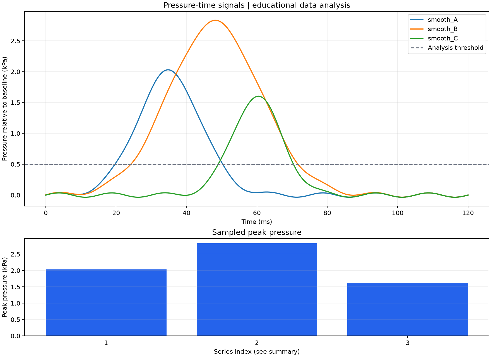

# Python Pressure Wave Analysis

一个可直接运行的 Python 压力—时间数据分析小项目：导入 CSV，检查数据质量，统计峰值、阈值以上累计时间与曲线面积，并导出图表及独立 HTML 报告。

项目用于练习工程数据处理、数值积分、科学绘图、命令行开发与自动化测试。随附数据由平滑高斯脉冲和小幅正弦扰动合成，代表通用教学信号；不包含爆炸超压预测、炸药当量、距离传播或损伤评估模型。



## 快速运行

需要 Python 3.10 或更新版本。建议在虚拟环境安装，运行以下命令：

```bash
git clone https://github.com/whc030019/python-pressure-wave-analysis.git
cd python-pressure-wave-analysis
python -m venv .venv
```

Windows PowerShell 激活环境：

```powershell
.\.venv\Scripts\Activate.ps1
```

macOS / Linux 激活环境：

```bash
source .venv/bin/activate
```

然后安装并运行：

```bash
python -m pip install -e .
pressure-analyze data/sample_signals.csv --output results
```

如果不激活环境，也可以在 Windows 直接运行 `.venv\Scripts\python.exe -m pip install -e .` 和 `.venv\Scripts\python.exe -m pressure_wave data/sample_signals.csv --output results`。

打开 `results/report.html` 查看完整报告；也可直接查看仓库中的 [已生成示例报告](docs/sample_report.html)（下载到本地后用浏览器打开）。

## 输出内容

| 文件 | 内容 |
| --- | --- |
| `report.html` | 内嵌图表与统计表，离线可打开，无网络资源依赖 |
| `pressure_overview.png` | 压力曲线和采样峰值对比 |
| `pressure_overview.svg` | 可缩放的矢量图 |
| `summary.csv` | 各序列统计结果 |
| `processed_signals.csv` | 已扣除常量基线的压力—时间数据 |

重复运行到同一输出目录会覆盖同名文件。建议重要结果分别保存到不同目录。

## 输入格式

CSV 使用 UTF-8 编码，支持 UTF-8 BOM。必需列名如下，允许附加其他列。

```csv
series_id,time_ms,pressure_kpa
sensor_A,0,0
sensor_A,1,2
sensor_A,2,0
```

- `series_id`：非空序列编号。
- `time_ms`：时间，单位毫秒；每组内严格递增，支持非等间隔采样。
- `pressure_kpa`：压力信号值，单位千帕。输入可以已经相对某个参考值归零，也可以使用命令行参数扣除常量基线。

每组至少三个点；不同组可以交错排列，但各自的时间必须保持递增。程序拒绝重复时间、缺列、空编号、非数值和 NaN/Inf，不静默排序、补值或丢弃样本。

## 分析参数

```bash
pressure-analyze my_data.csv --baseline-kpa 100 --threshold-kpa 0.5 --output my_results
```

上例从每个压力值减去 `100 kPa`，再分析相对压力高于 `0.5 kPa` 的区间。默认基线为 `0`、阈值为 `0.5 kPa`。阈值只服务于数据统计，不是安全或损伤标准。

处理后 CSV 已扣除基线，再次分析时应使用默认 `--baseline-kpa 0`，避免重复扣除。

## 数值方法

设校正后的压力为 `p = 输入压力 − 常量基线`。

| 统计项 | 含义 |
| --- | --- |
| `sample_count` | 采样点数量 |
| `observation_duration_ms` | 末时间减首时间 |
| `peak_pressure_kpa` | 采样点中的最大校正压力 |
| `peak_time_ms` | 首次出现最大值的输入时间坐标 |
| `min_pressure_kpa` | 采样点中的最小校正压力 |
| `signed_area_kpa_ms` | 压力曲线的有符号梯形积分 |
| `positive_area_kpa_ms` | 压力高于零的部分的面积 |
| `time_above_threshold_ms` | 所有严格高于阈值区间的累计时间 |

相邻点之间假设线性变化，用实际时间差积分；跨越零线或阈值时先插值求交点，再计算对应面积或持续时间。累计时间可以包含多个分离区间，不等于单个脉冲宽度。正面积不是简单地将负采样值截断后做梯形积分。

例如时间 `[0, 1, 2] ms`、压力 `[0, 2, 0] kPa`：峰值 `2 kPa`，曲线面积 `2 kPa·ms`，高于 `1 kPa` 的累计时间是 `1 ms`。

积分单位为 `kPa·ms`（数值上等于 `Pa·s`）。采样密度、测量噪声、基线选择会影响结果；本工具不自动平滑信号、不判断来源、不推断峰值点之间是否存在更大的真实峰值。

## 生成教学样本

```bash
python examples/generate_sample_data.py
```

生成三组固定的通用平滑脉冲信号，每组 241 点，共 723 点。生成脚本不读取装备或爆炸物参数。

## 运行测试

```bash
python -m unittest discover -s tests -v
```

测试覆盖解析积分、零交叉、阈值交叉、非均匀时间、多段持续时间、基线校正、异常输入、HTML 转义、图片导出和处理后 CSV 的再次导入。

## 目录

```text
src/pressure_wave/analysis.py    CSV 校验和数值统计
src/pressure_wave/report.py      图表、CSV 与 HTML 报告导出
src/pressure_wave/cli.py         命令行入口
examples/generate_sample_data.py 教学数据生成器
data/sample_signals.csv          可复现教学样本
tests/test_analysis.py           自动化测试
docs/                           真实运行生成的预览与示例报告
```

作品集介绍可写为：“使用 Python 实现压力—时间 CSV 数据校验、非等间隔数值积分、阈值区间插值及自动报告生成，并用解析样例与文件往返测试验证结果。”请在理解和运行代码后，按实际完成内容描述自己的项目经历。

许可证：MIT，见 [LICENSE](LICENSE)。
